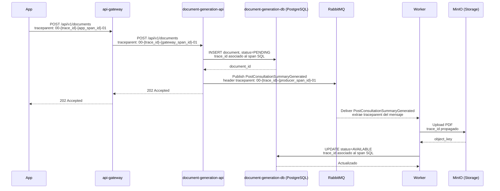

# Generate Consultation Document: distributed trace

## Flow Hops

| # | Source | Destination | Operation | Type |
|---|---|---|---|---|
| 1 | Patient App | `api-gateway` | REST `POST /api/v1/documents` | Synchronous |
| 2 | `api-gateway` | `document-generation-api` | REST `POST /api/v1/documents` | Synchronous |
| 3 | `document-generation-api` | `document-generation-db` (PostgreSQL) | SQL `INSERT`, status `PENDING` | Synchronous |
| 4 | `document-generation-api` | RabbitMQ | Publish `PostConsultationSummaryGenerated` | Asynchronous |
| 5 | Worker | MinIO (Storage) | Upload PDF | Synchronous |
| 6 | Worker | `document-generation-db` (PostgreSQL) | SQL `UPDATE`, status `AVAILABLE` | Synchronous |

## Sequence Diagram

The `traceparent` preserves the same `trace_id`; each service creates its own `span_id`. The worker extracts the context propagated in the RabbitMQ message headers.

## Span Tree

- Root Span: `POST /documents (api-gateway)` (`trace_id: 4bf92f3577b34da6a3ce929d0e0e4736`)
  - Child Span: `POST /documents (document-generation-api)` (same `trace_id`)
    - Child Span: `INSERT status=PENDING (PostgreSQL)` (same `trace_id`)
    - Child Span: `publish PostConsultationSummaryGenerated (RabbitMQ)` (same `trace_id`)
      - Linked Async Span: `consume PostConsultationSummaryGenerated (Worker in document-generation-api)` (linked to the publish span)
        - Child Span: `Upload PDF (MinIO)` (same propagated `trace_id`)
        - Child Span: `UPDATE status=AVAILABLE (PostgreSQL)` (same propagated `trace_id`)
