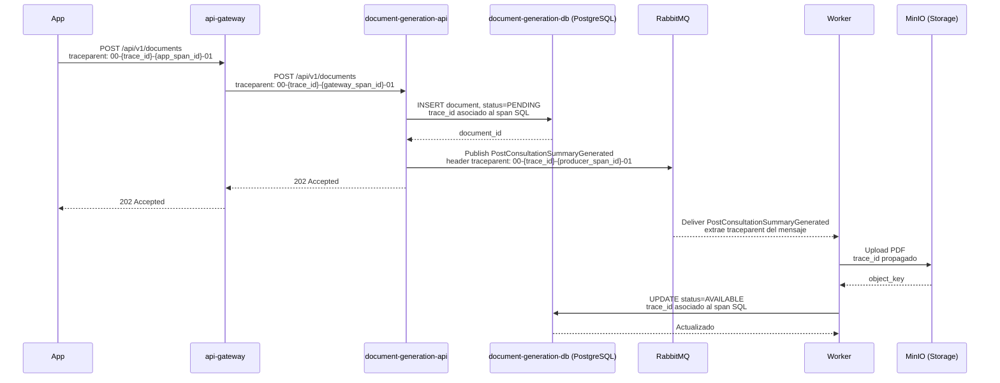

# Generate Consultation Document: distributed trace

## Saltos del flujo

| # | Origen | Destino | Operación | Tipo |
|---|---|---|---|---|
| 1 | Patient App | `api-gateway` | REST `POST /api/v1/documents` | Síncrono |
| 2 | `api-gateway` | `document-generation-api` | REST `POST /api/v1/documents` | Síncrono |
| 3 | `document-generation-api` | `document-generation-db` (PostgreSQL) | SQL `INSERT`, estado `PENDING` | Síncrono |
| 4 | `document-generation-api` | RabbitMQ | Publicar `PostConsultationSummaryGenerated` | Asíncrono |
| 5 | Worker | MinIO (Storage) | Subir PDF | Síncrono |
| 6 | Worker | `document-generation-db` (PostgreSQL) | SQL `UPDATE`, estado `AVAILABLE` | Síncrono |

## Diagrama de secuencia

El `traceparent` conserva el mismo `trace_id`; cada servicio crea su propio `span_id`. El worker extrae el contexto propagado en los headers del mensaje RabbitMQ.

## Span Tree

- Root Span: `POST /documents (api-gateway)` (`trace_id: 4bf92f3577b34da6a3ce929d0e0e4736`)
  - Child Span: `POST /documents (document-generation-api)` (mismo `trace_id`)
    - Child Span: `INSERT status=PENDING (PostgreSQL)` (mismo `trace_id`)
    - Child Span: `publish PostConsultationSummaryGenerated (RabbitMQ)` (mismo `trace_id`)
      - Linked Async Span: `consume PostConsultationSummaryGenerated (Worker in document-generation-api)` (contexto vinculado al span de publicación)
        - Child Span: `Upload PDF (MinIO)` (mismo `trace_id` propagado)
        - Child Span: `UPDATE status=AVAILABLE (PostgreSQL)` (mismo `trace_id` propagado)
