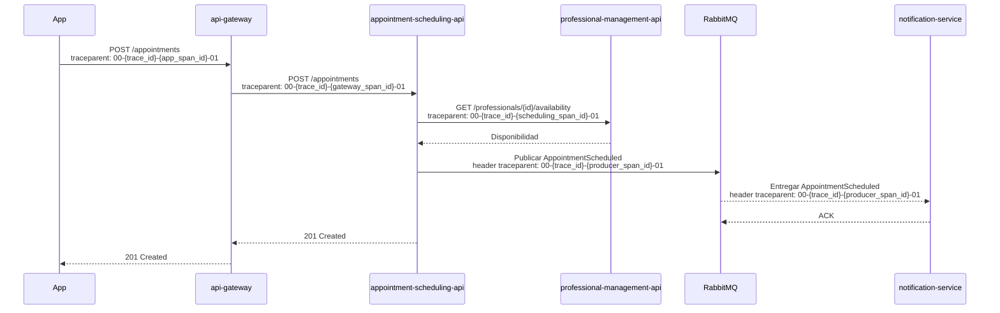

# Schedule Appointment: distributed trace

## Saltos del flujo

| Origen | Destino | Tipo | Propagación |
|---|---|---|---|
| App | `api-gateway` | HTTP síncrono | `traceparent` |
| `api-gateway` | `appointment-scheduling-api` | HTTP síncrono | Reenvía `traceparent` |
| `appointment-scheduling-api` | `professional-management-api` | HTTP síncrono | Reenvía `traceparent` |
| `appointment-scheduling-api` | RabbitMQ | Publicación asíncrona | Propaga el contexto de trace en headers del mensaje |
| RabbitMQ | `notification-service` | Consumo asíncrono | Extrae el contexto de trace de los headers del mensaje |

## Secuencia

## Span Tree

- Root Span: `App POST /appointments` (`trace_id: 4bf92f3577b34da6a3ce929d0e0e4736`)
  - Child Span: `api-gateway POST /appointments` (mismo `trace_id`)
    - Child Span: `appointment-scheduling-api POST /appointments` (mismo `trace_id`)
      - Child Span: `professional-management-api GET /professionals/{id}/availability` (mismo `trace_id`)
      - Async Span: `appointment-scheduling-api publish AppointmentScheduled → RabbitMQ → notification-service consume AppointmentScheduled` (mismo `trace_id`; conserva el contexto al cruzar la cola)
