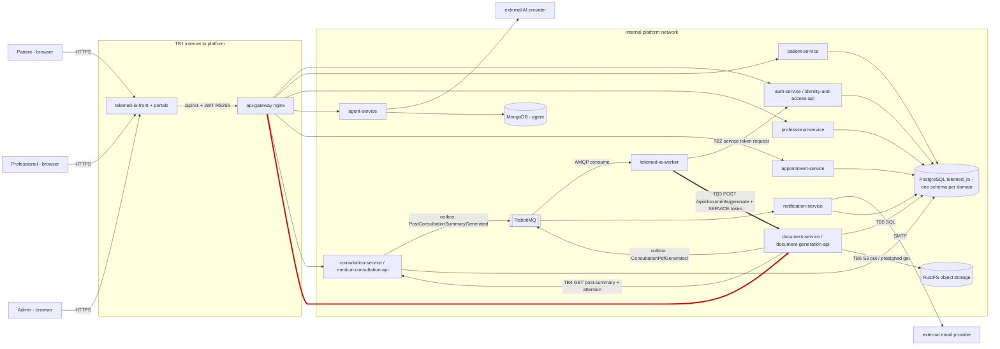

# CP1 · Attack surface and trust boundaries

Sources: `telemed-ia-docs` `05-architecture/overview.md`, `07-api/contracts/openapi/document-service.yaml`,
`09-microservices/services/09-document-service/decisions.md` (DEC-006 to DEC-009) and ADR-011.

## Data flow

| Id | Boundary | Owner |
|---|---|---|
| TB1 | Internet → `api-gateway` | @JulianaFerro1428 (#139) |
| TB2 | `telemed-ia-worker` → `identity-and-access-api` (`POST /internal/service-token`) | – |
| **TB3** | **`telemed-ia-worker` → `document-generation-api` (`POST /api/documents/generate`)** | **@Sofialjure (#141)** |
| TB4 | `document-generation-api` → `medical-consultation-api` | – |
| TB5 | services → PostgreSQL | @BondrewdXD (#140) |
| TB6 | `document-generation-api` → RustFS | – |

## Asset inventory (document domain)

| Asset | Where it lives / crosses | Classification |
|---|---|---|
| Consultation PDF (diagnosis, medications, recommendations) | RustFS bucket, rendered in `document-generation-api` | Restricted |
| Clinical summary read from consultation (`AttentionSummary`) | memory of `document-generation-api` during one attempt (TB4) | Restricted |
| `SERVICE` access token of the worker (`sub: worker`, 10 min) | header `Authorization` across TB3 | Restricted |
| `SERVICE_CLIENT_SECRET` of worker and document API | environment of each container | Restricted |
| `consultation_document` row (`summaryId`, `patientId`, `status`, `retryCount`) | schema `document_generation` in PostgreSQL | Confidential |
| `idempotency_key` row (key, request hash, document id) | schema `document_generation` | Internal |
| `outbox_event` row `ConsultationPdfGenerated` (ids only) | schema `document_generation`, then RabbitMQ | Internal |
| Presigned download URL (5 min) | response of `GET /api/documents/{id}/download` | Confidential |

## Entry points of TB3

| Entry point | Caller | Authentication today |
|---|---|---|
| `POST /api/documents/generate` on `document-generation-api:8080`, body `{summaryId, patientId}` + `Idempotency-Key` | `telemed-ia-worker` after consuming `PostConsultationSummaryGenerated` | JWT RS256 verified in the API (`AuthFilter`); role `ADMIN`, or `SERVICE` with `sub` in `GENERATION_SERVICE_CLIENTS` (DEC-007) |
| Queue of `PostConsultationSummaryGenerated` (+ DLQ) in RabbitMQ | `medical-consultation-api` outbox poller publishes, worker consumes | RabbitMQ user and password of each service |
| Port 8080 of the API inside the platform network | any container on the same Docker network | none at network level: only the JWT check |
| Management port 9081 (`/actuator/health`, `prometheus`, `generation` pause switch) | Prometheus, on-call engineer | none: network isolation only, never published or routed by the gateway |
